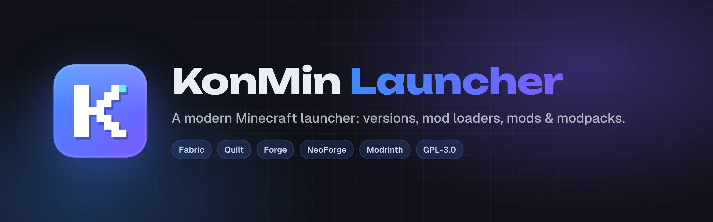
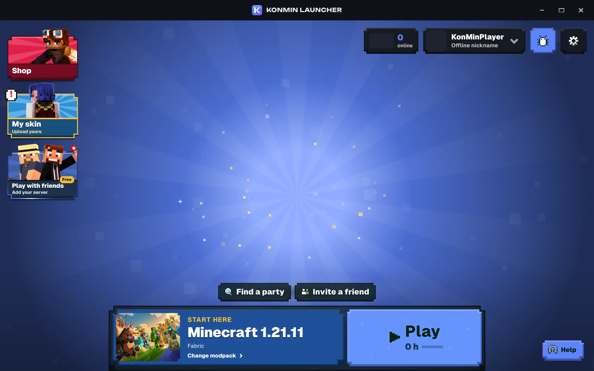
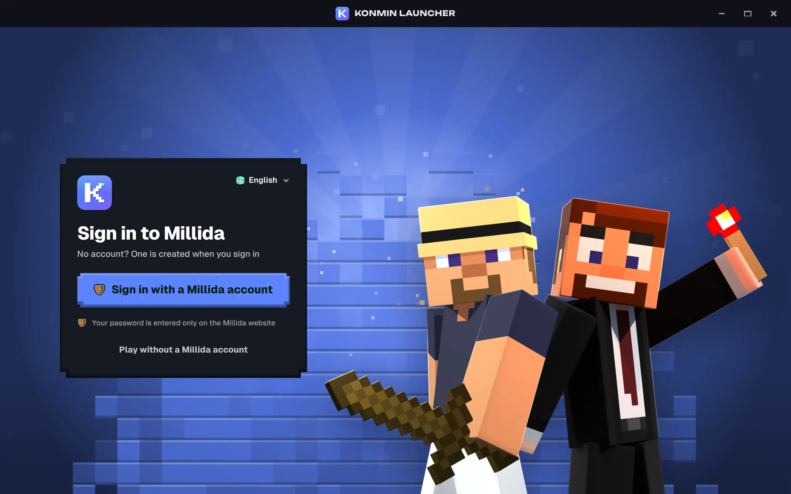
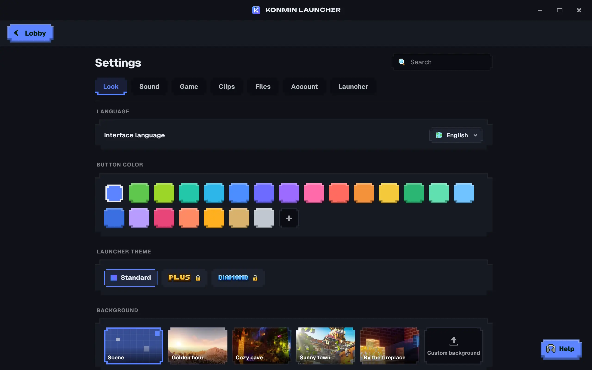
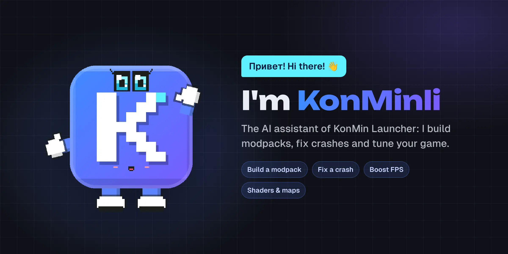

<p align="center">
  
</p>

<p align="center">
  <a href="LICENSE"></a>
  
  
  
</p>

*English | Русская версия: [README.ru.md](README.ru.md)*

**KonMin Launcher** is a desktop Minecraft launcher for Windows, macOS and Linux with a dark,
modern interface. It installs and starts any Minecraft version, sets up Fabric, Quilt, Forge and
NeoForge, downloads the right Java by itself, and installs mods, modpacks, resource packs and
shaders from Modrinth and CurseForge.

> KonMin Launcher is a fork of the open-source [Millida Launcher](https://github.com/millida/launcher)
> (GPL-3.0-only). It is **not affiliated with, endorsed by or supported by Millida**. Millida's
> online services that the code still uses are listed in [EXTERNAL-SERVICES.md](EXTERNAL-SERVICES.md).

<p align="center">
  
</p>

| Sign-in | Settings |
| :---: | :---: |
|  |  |

<sub>Screenshots are from the browser preview (`bun run dev`), where screens that need the Rust core show placeholders.</sub>

## Features

- **Any version of Minecraft**: releases and snapshots from Mojang's official manifest; every
  file is checked against Mojang's hashes.
- **Mod loaders**: Fabric, Quilt, Forge and NeoForge are installed automatically.
- **Java is automatic**: the right Eclipse Temurin build is downloaded and verified for each version.
- **Mods and modpacks**: search and install from Modrinth and CurseForge, `.mrpack` and CurseForge
  archives, dependency resolution, updates, a mod scanner and quarantine.
- **Accounts**: Microsoft (licensed) through the official device-code sign-in, offline nickname,
  and, optionally, a Millida account for Millida's online features.
- **Instances**: import from Prism, MultiMC, ATLauncher, GDLauncher, CurseForge, Modrinth App and
  `.minecraft`; worlds, backups, screenshots, logs, crash diagnosis and one-click fixes.
- **Performance**: automatic memory/GC tuning and an FPS Boost mode per instance.
- **Look**: KonMin blue-violet theme, 20+ accent colours, wallpapers, 21 interface languages.
- **Security**: tokens never leave the Rust core (AES-256-GCM vault), all downloads are hash-checked,
  strict CSP and a minimal webview permission set. See [ARCHITECTURE.md](ARCHITECTURE.md).

## What differs from Millida Launcher

| | Millida Launcher | KonMin Launcher |
| --- | --- | --- |
| Name, icon, colours, identifier | Millida, green, `net.millida.launcher` | KonMin, blue-violet, `com.konmin.launcher` |
| Executable / installer | `millida-launcher.exe`, `Millida Launcher_<v>_x64-setup.exe` | `konmin-launcher.exe`, `KonMin Launcher_<v>_x64-setup.exe` |
| Data folder | `%APPDATA%\net.millida.launcher` | `%APPDATA%\com.konmin.launcher` (fresh install, nothing is shared) |
| Entering the app | a Millida account is required | **"Play without a Millida account"**: Microsoft licence or offline nickname is enough |
| Microsoft sign-in | Millida's Azure app | your own Azure app via `KONMIN_MS_CLIENT_ID` (see below) |
| Auto-update | Millida's update server and signing key | off until you configure your own channel |
| Usage statistics | on by default, sent to Millida | **off by default** (opt-in), still sent to Millida's API when turned on |
| Discord Rich Presence | Millida's Discord app | off unless `KONMIN_DISCORD_APP_ID` is set |
| Deep links | `millida://` | `konmin://` |

Full list of third-party services, and of what still depends on Millida: [EXTERNAL-SERVICES.md](EXTERNAL-SERVICES.md).

## Build

You need [Bun](https://bun.sh), [Rust](https://rustup.rs) (stable) and the
[Tauri 2 prerequisites](https://tauri.app/start/prerequisites/) for your OS. Step-by-step
instructions per platform: [BUILDING.md](BUILDING.md).

```bash
bun install
bun run tauri dev          # run the app from source
bun run tauri build        # installers in src-tauri/target/release/bundle/
```

On Windows the result is `src-tauri\target\release\bundle\nsis\KonMin Launcher_<version>_x64-setup.exe`.

### Build-time configuration

| Variable | Needed for | Default |
| --- | --- | --- |
| `KONMIN_MS_CLIENT_ID` | Microsoft (licensed) sign-in. Register an app in Microsoft Entra ID for **personal Microsoft accounts**, enable "Allow public client flows" (device code), and request access to the Minecraft API from Microsoft for the app. | unset: Microsoft sign-in says it is not configured; offline play works |
| `KONMIN_DISCORD_APP_ID` | Discord Rich Presence (also read at run time) | unset: presence off |
| `KONMIN_SITE_URL` | "Download launcher" button in Discord presence | unset: no button |
| `VITE_KONMIN_DOWNLOAD_PAGE` | page opened when an automatic update fails | unset: nothing opened |
| `plugins.updater.endpoints` / `pubkey` in `src-tauri/tauri.conf.json` | auto-update: your `latest.json` URLs and the public key from `bunx tauri signer generate` | empty: no update checks |

Never commit secrets: the Azure client id and the updater **public** key are not secrets; the
updater **private** key must stay in your CI secrets (`TAURI_SIGNING_PRIVATE_KEY`).

## Checks

```bash
bun run typecheck                                  # TypeScript (strict)
bun run test                                       # frontend and script tests
bun run build:web                                  # production web build + gates
cd src-tauri
cargo clippy --all-targets -- -D warnings
cargo test
```

## KonMinli: logo, icon and AI assistant

<p align="center"></p>

**КонМинли (KonMinli)** is the KonMin logo turned into a character: the same blue-violet tile, pixel K
and cyan spark, with a face in the logo's empty margins. It is the launcher logo, the application icon
(window, taskbar, Windows installer) and the in-app AI assistant at once. The assistant's features are
unchanged from upstream ("Milli"): building modpacks, fixing crashes, tuning configs, chat history.
It answers through Millida's AI service, so it needs a Millida account sign-in (see
[EXTERNAL-SERVICES.md](EXTERNAL-SERVICES.md)).

- `branding/`: every KonMinli asset (logo SVG, icon, avatars, expressions, welcome art) and how to
  regenerate them: [branding/README.md](branding/README.md)
- `src/components/milli/`: the live mascot (22 emotions, animations) and the assistant
- Colour tokens: `src/styles/02-kit.css` (`--m-bg #0F1117`, accent `#5C84FF`, gradient `#3D8BFF → #7B5CFF`)

## Known limitations

- Online features that use Millida's API (Millida account, friends, chat, calls, catalog
  purchases, Millida skins and cosmetics, cloud sync, hosting panel, CurseForge **search**) depend
  on Millida's servers, which may block unofficial builds at any time.
- Builds are not code-signed: Windows SmartScreen and macOS Gatekeeper will warn.
- Wallpapers, lobby art and music in `public/` and `media/` are upstream artwork; replace them
  before distributing builds publicly (see [TRADEMARK.md](TRADEMARK.md)).
- `installer/` (upstream's web installer) and the release workflows under `.github/workflows/`
  belong to Millida's release pipeline and are not used for KonMin.

## License

GPL-3.0-only, see [LICENSE](LICENSE) and [NOTICE](NOTICE). KonMin Launcher is a modified version of
Millida Launcher © Millida (Roman Babaskin); modifications © KonMin. Third-party components:
[THIRD-PARTY.md](THIRD-PARTY.md). The upstream trademark policy that applies to the Millida name
and assets is in [TRADEMARK.md](TRADEMARK.md).

<sub>KonMin Launcher is not affiliated with Mojang AB, Microsoft or Millida. Minecraft is a trademark of Mojang AB.</sub>
