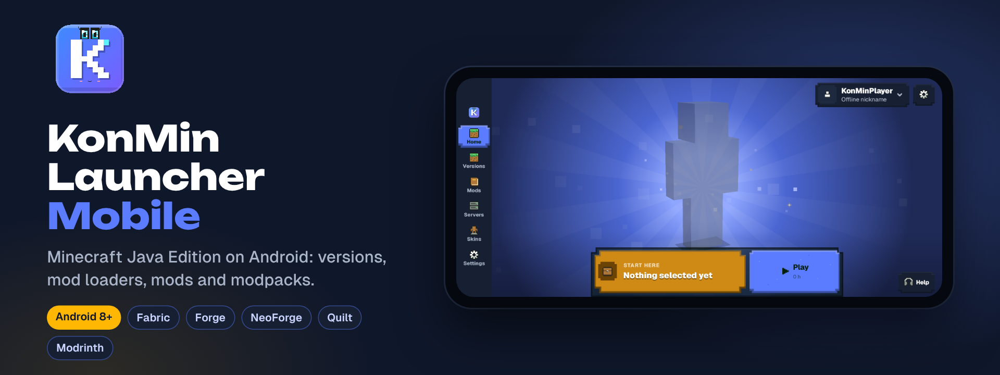

  

*Русский | English version: [README.md](README.md)*

**KonMin Launcher Mobile** — лаунчер **Minecraft Java Edition** для Android: те же версии, что на
компьютере, Fabric, Quilt, Forge и NeoForge, моды и сборки с Modrinth и CurseForge, ресурспаки, шейдеры,
миры, сенсорное управление, клавиатура, мышь и геймпад.

> KonMin Launcher Mobile — форк открытого [Millida Launcher Mobile](https://github.com/millida/launcher-mobile)
> (GPL-3.0-only). Он **не связан с Millida, не одобрен и не поддерживается Millida**. Что изменено —
> в [MODIFICATIONS.md](MODIFICATIONS.md).

## Установка на телефон

1. Скачай APK: со страницы **Releases** этого репозитория или во вкладке **Actions** → последний зелёный
   запуск *Android APK* → **Artifacts** → `KonMin-Launcher-Mobile` (нужен вход в GitHub; внутри zip — APK).
2. Открой `KonMin-Launcher-Mobile-debug.apk` и разреши установку из этого источника.
3. Открой **KonMin**, выбери, как играть (лицензия Microsoft или офлайн-ник), создай сборку в разделе
   **Версии** и нажми **Играть**. Файлы игры скачаются с серверов Mojang один раз.

Нужно: Android 8.0+, 64-битный процессор (arm64), от 4 ГБ памяти, OpenGL ES 3.0 (3.2 для шейдеров).
Не каждая версия и не каждый мод одинаково хорошо идут на любом телефоне: на слабых начни с ванили или
Fabric и дальности прорисовки 6.

## Что внутри

- Разделы: **Главная**, **Версии**, **Моды**, **Серверы**, **Скины**, **Настройки**.
- Настоящий движок оригинального проекта: версии Mojang с проверкой хешей, установка загрузчиков,
  OpenJDK 8/21/25 для Android, рендереры Krypton, GL4ES, ANGLE, MobileGlues, SDL3, ввод с экрана,
  клавиатуры, мыши и геймпада.
- Пакет Java и графики встроен в APK (собран из открытых источников), так что игре не нужен сервер лаунчера.
- Вход Microsoft — через официальную страницу по коду, пароль приложение не видит; офлайн-ники.

## Сборка в облаке с телефона

Отправь коммит в ветку `konmin-mobile` или открой **Actions → Android APK → Run workflow**. Подробно — в
[BUILDING.md](BUILDING.md).

## Онлайн-сервисы

Без настройки сборка обращается только к Mojang/Microsoft, Modrinth, CDN файлов CurseForge, сайтам
загрузчиков и источникам Java. Вход Microsoft включается своим `konmin.msClientId`; сервисы Millida
(аккаунт, друзья, чат, магазин, хостинг, рейтинг серверов, статистика) выключены, и запросы к Millida не
уходят вовсе.

## Лицензия

GPL-3.0-only ([LICENSE](LICENSE)). Распространяя APK, нужно также предоставить его исходный код.

KonMin Launcher Mobile не связан с Mojang AB, Microsoft и Millida. Minecraft — товарный знак Mojang AB.
